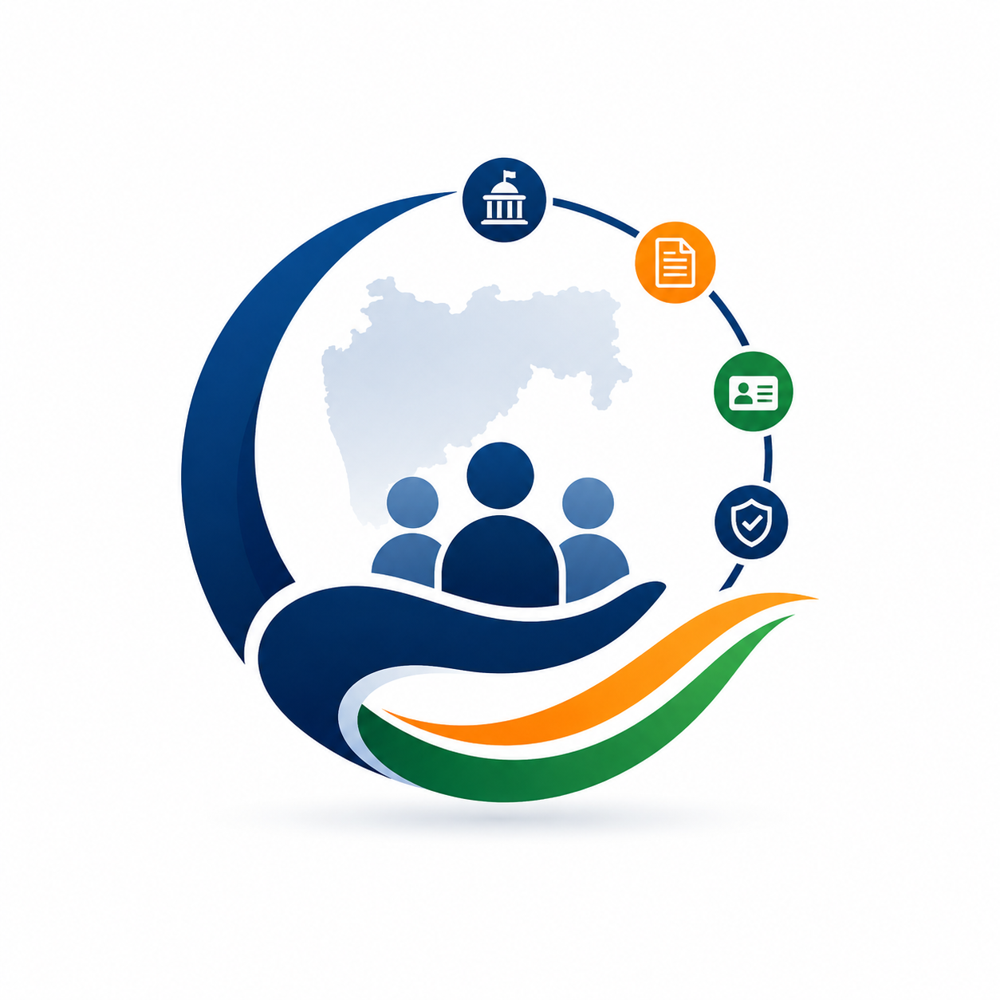
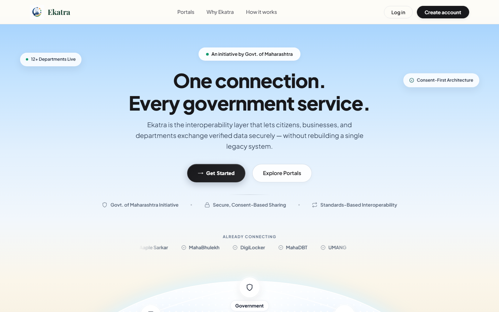
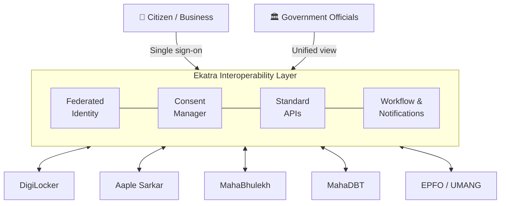

<div align="center">



# Ekatra

### One connection. Every government service.

An interoperability layer that lets citizens, businesses and government departments exchange **verified data securely**, without rebuilding a single legacy system.

[](https://ekatra-tech.web.app/)




</div>

> **Note:** Ekatra is an independent student prototype. It is not affiliated with, or endorsed by, any government body.

---

## 📑 Table of Contents

- [About](#-about)
- [Key Features](#-key-features)
- [Architecture](#-architecture)
- [Connected Portals](#-connected-portals)
- [Impact](#-impact)
- [Tech Stack](#-tech-stack)
- [Project Structure](#-project-structure)
- [Getting Started](#-getting-started)
- [Roadmap](#-roadmap)
- [Author](#-author)

---

## 💡 About

**The problem:** Government services in India are spread across dozens of portals (DigiLocker, Aaple Sarkar, MahaBhulekh, MahaDBT, EPFO and more). Each has its own login, its own forms and its own copy of your data. Citizens re-upload the same documents and repeat e-KYC again and again, and departments rely on manual, point-to-point integrations to talk to each other.

**The solution:** Ekatra is **an interoperability layer, not another portal**. Citizens sign in once, connect the portals they use, and give explicit consent for departments to share verified records with each other. Existing systems stay as they are; Ekatra connects them through standard APIs.

---

## ✨ Key Features

| Feature | Description |
|---|---|
| 🔐 **Federated Identity / SSO** | One account for every linked portal, so e-KYC is done once. |
| ✅ **Consent-Based Sharing** | Citizens approve every data request, and every access is logged. |
| 🔗 **Standards-Based APIs** | Departments exchange data through common, documented API formats instead of custom integrations. |
| 🗂️ **Master Data Management** | A single, consistent citizen record kept in sync across departments. |
| 🔔 **Event Notifications** | Status updates when an application or data request moves forward. |
| ⚙️ **Workflow Orchestration** | Automated hand-offs between departments for multi-step services. |
| 🧑‍💼 **Citizen Workspace** | A personal dashboard with linked portals, a verified document wallet, data requests and recent activity. |

---

## 🏗️ Architecture



1. A citizen signs in once and links the portals they use.
2. When a department needs a record, Ekatra asks the citizen for consent.
3. Once approved, the verified record is shared through a standard API, and the access is logged.
4. Officials see one consolidated view instead of switching between systems.

---

## 🌐 Connected Portals

DigiLocker · Aaple Sarkar · MahaBhulekh · myAadhaar (UIDAI) · MahaDBT · Parivahan Sewa · PM-KISAN · UMANG · EPFO

---

## 📈 Impact

| Stakeholder | Benefit |
|---|---|
| **Citizens & businesses** | One account and one dashboard, with no repeated document uploads |
| **Government officials** | A consolidated view of applications and automatic hand-offs between departments |
| **IT & department teams** | Standard APIs replace fragile point-to-point integrations |

---

## 🛠️ Tech Stack

| Layer | Technology |
|---|---|
| **Frontend** | HTML5, CSS3, vanilla JavaScript |
| **Authentication** | Firebase Authentication (email and Google sign-in) |
| **Database** | Cloud Firestore (user profiles, linked portals, requests) |
| **Hosting** | Firebase Hosting |
| **Fonts** | Plus Jakarta Sans, Playfair Display |

---

## 📁 Project Structure

```
Ekatra/
├── index.html            # Landing page, sign-in, onboarding and citizen workspace
├── firebase-config.js    # Firebase web app configuration
├── logo.png              # Brand logo
└── docs/
    └── screenshot.png
```

---

## 🚀 Getting Started

**Prerequisites:** a modern browser and [Node.js](https://nodejs.org) (only for the local server).

```bash
# 1. Clone the repository
git clone https://github.com/dhruvagrawal514-boop/Ekatra.git
cd Ekatra

# 2. Start a local server
npx serve .
```

Then open the URL it prints (usually `http://localhost:3000`).

**Using your own Firebase project**

1. Create a project in the [Firebase console](https://console.firebase.google.com) and add a web app.
2. Enable **Authentication** (Email/Password and Google) and **Cloud Firestore**.
3. Replace the values in `firebase-config.js` with your project's config.

---

## 🗺️ Roadmap

- [x] Landing page explaining the interoperability layer
- [x] Sign-up, sign-in and profile onboarding
- [x] Citizen workspace with linked portals, document wallet and data requests
- [ ] Live DigiLocker API integration
- [ ] Consent records with tamper-proof audit trail
- [ ] Officials' dashboard with SLA tracking
- [ ] SMS and WhatsApp notifications

---

## 👤 Author

**Dhruv Agrawal**

[](https://www.linkedin.com/in/dhruv-agrawal-0b8a46204)
[](https://github.com/dhruvagrawal514-boop)
[](mailto:dhruvagrawal514@gmail.com)

<div align="center">

If you like this project, consider giving it a ⭐

</div>
